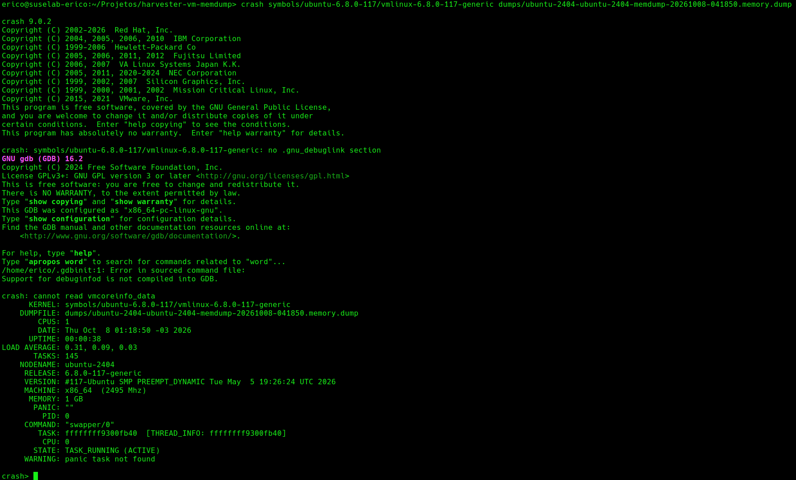
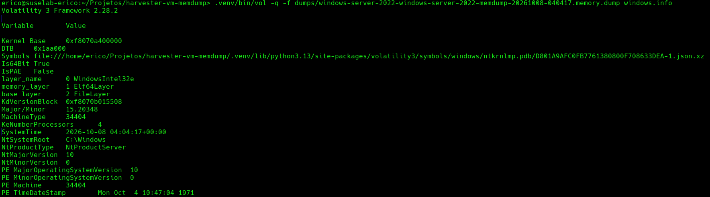

# Analyzing a memory dump (Linux guest)

Verified 2026-10-08 on a dump of `labs/ubuntu-2404` (Ubuntu 24.04, kernel 6.8.0-117-generic,
1 GiB RAM, 1 vCPU) using `crash` 9.0.2 on openSUSE.

The dump is a QEMU memory-only ELF core (`ET_CORE`). The LOAD segments are guest-physical
memory. It contains RAM only: no disk, and only the vCPU register state QEMU puts in the NOTE segment.

## 1. Prepare
```bash
sudo zypper in crash
gunzip -k <vm>-<pvc>-<ts>.memory.dump.gz
```

## 2. Identify the guest kernel (no symbols needed)
```bash
grep -a -o -m1 "Linux version [^\n]*" <dump>.memory.dump
```
You need the debug `vmlinux` of **exactly** that build.

## 3. Get matching symbols
Ubuntu (debug packages live on ddebs.ubuntu.com):
```bash
V=6.8.0-117   # from step 2
curl -O http://ddebs.ubuntu.com/pool/main/l/linux/linux-image-unsigned-$V-generic-dbgsym_$V.117_amd64.ddeb
ar p linux-image-unsigned-*.ddeb data.tar.xz | tar -xJ --wildcards './usr/lib/debug/boot/vmlinux-*'
```
(The package is ~1.7 GB; `vmlinux` is ~415 MB. The ddeb version suffix, `.117` here, is the
upload number; list the directory to find it.) Do this in an empty directory.
A copy of this one is kept in `symbols/ubuntu-6.8.0-117/vmlinux-6.8.0-117-generic`.

Other distros: SUSE `kernel-default-debuginfo`, RHEL `kernel-debuginfo`, Debian `linux-image-*-dbg`.

## 4. Open it
```bash
crash symbols/ubuntu-6.8.0-117/vmlinux-6.8.0-117-generic <dump>.memory.dump
```
Expected harmless noise:
- `no .gnu_debuglink section` (the extracted vmlinux has no debuglink).
- `cannot read vmcoreinfo_data`: QEMU did not embed vmcoreinfo, but `crash` still worked here
  without any `--machdep`/`--kaslr` flags. If a future dump fails to open, try `--kaslr=auto`.
- A `~/.gdbinit` debuginfod error if your gdbinit sources one; it does not affect `crash`.

## 5. First commands
| Command      | Shows |
|--------------|-------|
| `sys`        | kernel/uptime/tasks/memory summary, `PANIC:` string if the kernel panicked |
| `log`        | guest kernel ring buffer (`dmesg`). Start here for oops/OOM/hung-task messages |
| `bt`         | backtrace of the current task (use `bt -a` for all CPUs) |
| `ps`         | all tasks; `ps -u` user tasks only; `ps \| grep UN` uninterruptible (stuck on I/O) |
| `bt <pid>`   | stack of a specific task, e.g. one stuck in `D` state |
| `kmem -i`    | memory usage summary; `kmem -s` slab caches |
| `foreach UN bt` | backtraces of every task in uninterruptible sleep (typical hang triage) |
| `files <pid>`, `net`, `mod`, `dev`, `irq` | open files, network, modules, devices, IRQs |

Sample (idle healthy VM, the dump in the screenshot below): `sys` reported `TASKS: 145`,
`UPTIME: 00:00:38`, `PANIC: ""`, running `swapper/0` on CPU 0; `kmem -i` showed 896.7 MB total, 48% free.



The `no .gnu_debuglink section`, `Support for debuginfod is not compiled into GDB` and
`cannot read vmcoreinfo_data` lines above the summary are the harmless noise described in step 4.
`WARNING: panic task not found` is expected because the guest did not panic.

## 6. Tips
- A dump of a healthy running VM is a snapshot, not a crash dump. For a real hang, take the dump
  while the guest is still hung, before rebooting.
- `crash` shows a vCPU's state at dump time. With `PANIC: ""` and `swapper` on every CPU the guest was idle.
- For the guest's own panics, configure `kdump` inside the VM: that produces a normal vmcore.
- Quick look without symbols: `strings -n 8 <dump> | grep -iE "oom|panic|BUG:|Call Trace"`.

## Windows guests (Volatility 3)

Verified 2026-10-08 on `labs/windows-server-2022` (Windows Server 2022, build 10.0.20348,
6 GiB RAM, 4 vCPUs). `vm-memdump.sh` worked unchanged: 14Gi PVC, 6.0 GiB dump, 551 MB gzipped.
Volatility 3 2.28.2 reads the QEMU ELF core directly (it reports an `Elf64Layer`), and
there is no need to convert it.

```bash
python3 -m venv .venv && .venv/bin/pip install volatility3
gunzip -k dumps/<dump>.memory.dump.gz
.venv/bin/vol -q -f dumps/<dump>.memory.dump windows.info
```

- Needs internet on the first run: Volatility downloads the matching `ntkrnlmp.pdb` symbol table
  from Microsoft's symbol server and caches it (in the venv's `volatility3/symbols/windows/`).
  `windows.info` took ~40 s on 6 GiB.
- Results seen: kernel base `0xf8070a400000`, 4 CPUs, `NtProductServer`, 10.0 / build 20348,
  `windows.pslist` (System, smss, csrss, wininit, lsass, svchost, ...), `windows.cmdline`,
  `windows.netscan` (listeners on 135/139/49664-49667, an established connection from svchost).



`memory_layer` is `Elf64Layer`, which confirms Volatility reads the QEMU core directly.
The odd `PE TimeDateStamp` (1971) is a quirk of the kernel image's build timestamp, not a dump problem.

Useful plugins:

| Plugin | Shows |
|--------|-------|
| `windows.info` | OS build, kernel base, CPU count, system time |
| `windows.pslist` / `windows.pstree` / `windows.psscan` | processes (`psscan` also finds hidden/exited ones) |
| `windows.cmdline`, `windows.dlllist`, `windows.handles` | command lines, loaded DLLs, handles |
| `windows.netscan` | TCP/UDP sockets |
| `windows.malfind` | suspicious executable memory regions |
| `windows.modules`, `windows.driverscan` | kernel modules / drivers |
| `windows.registry.hivelist` | registry hives |

Notes:
- Timestamps in `pslist`/`netscan` can look inconsistent (process start times of 11:02 UTC vs a
  system time of 04:04 UTC). That is guest clock/time-zone skew, not a dump problem.
- For WinDbg, convert the dump first: see [Opening the dump in WinDbg](#opening-the-dump-in-windbg).
- For a real BSOD, configure the guest to write a complete memory dump (`MEMORY.DMP`) instead.

### Opening the dump in WinDbg

WinDbg does not open the QEMU ELF core; it expects a Windows `MEMORY.DMP`. Convert it:

```bash
python3 -m venv .venv && .venv/bin/pip install memprocfs
.venv/bin/python elf2windmp.py dumps/<dump>.memory.dump.gz out.dmp
```

`elf2windmp.py` writes the ELF LOAD segments to a sparse raw image and has MemProcFS generate the crash
dump, which decodes the `KdDebuggerDataBlock` (its `KDBG` tag is encoded in raw memory) and fills the
`DUMP_HEADER64`. It takes 30-40 s for ~6 GiB. `out.dmp` is sparse: 7.75-8 GiB apparent size for these
5.75-6 GiB guests (it spans the physical address range, including the gap below 4 GiB), but far less on
disk. Copy it with `cp --sparse=always` or `rsync -S`; `scp` and HTTP send the full apparent size.

Verified (2026-10-19):

| VM | Checks | Result |
|----|--------|--------|
| `labs/windows-server-2022` (idle, 6 GiB) | header, Volatility 3, MemProcFS, **WinDbg 10.0.22621.755** | header `PAGEDU64`, build 20348, 4 CPUs, DTB `0x1aa000`; Volatility reads it as `WindowsCrashDump64Layer` with the same kernel base and build as the ELF run; WinDbg: "Kernel Complete Dump File: Full address space is available", kernel symbols and unloaded module list load, `lm` lists modules, `!process 0 0` walks the process list (System DirBase `001aa000`, smss, csrss, sppsvc, ...) |
| `labs/winsrv2022` (running, 5.75 GiB) | header, Volatility 3, MemProcFS | `PAGEDU64`, build 20348, 4 CPUs, DTB `0x1aa000`, `KDBG` tag decoded; `windows.info` and `windows.pslist` work (System, smss, csrss, wininit, services, lsass, svchost, ...). Not opened in WinDbg. |

Notes:
- The header's BugCheckCode is `0xdeaddead` because the VM did not crash, so WinDbg prints
  `Unknown exception - code 00000000`. Use the file for live-state inspection, not BSOD analysis; for a
  real BSOD configure the guest to write a complete `MEMORY.DMP`.
- `.reload /f` prints `Unable to load image ...` for drivers (`pvvx*`, `virtio_serial`, `fwcfg`, ...) that are
  not on the analysis machine's disk. That is harmless: the dump and symbols load fine.
- WinDbg from the Microsoft Store/`.appinstaller` does not install on Windows Server 2022 build 20348
  (`0x80073CF9` / `0x8007007F`). Use another machine, or the classic debuggers from the Windows SDK.
  On Server Core there is no GUI; `kd.exe -z <dump>` works.
- Not tried: `!analyze -v`, Windows guests other than Server 2022 build 20348.
- Having QEMU write the Windows format itself (`virsh dump --format win-dmp` in the `virt-launcher` pod)
  does not work on stock Harvester: no `vmcoreinfo` device in the domain, see the README.
